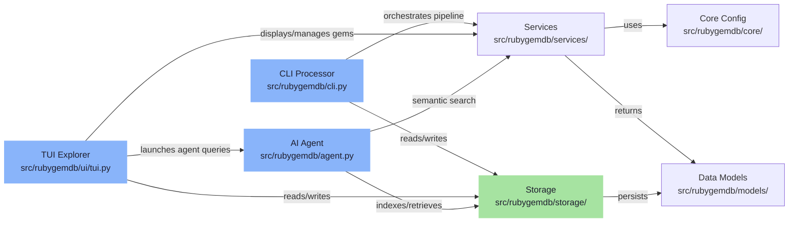
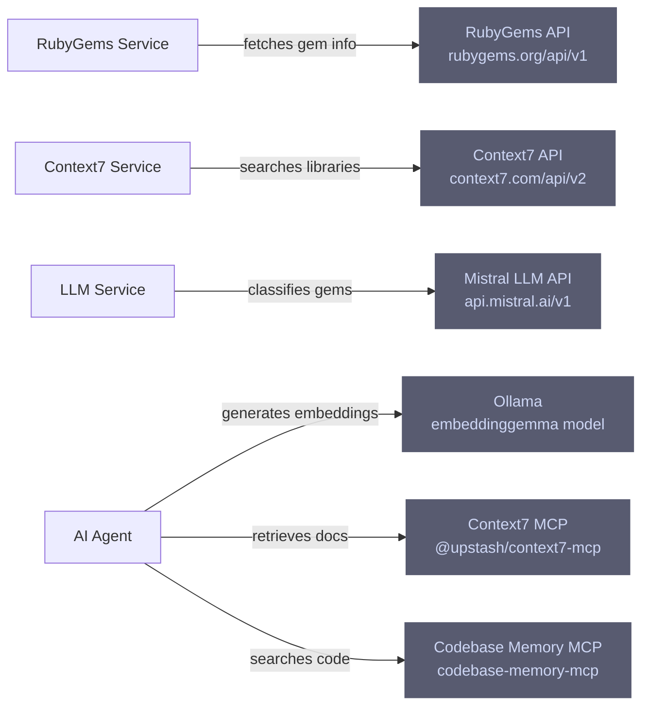
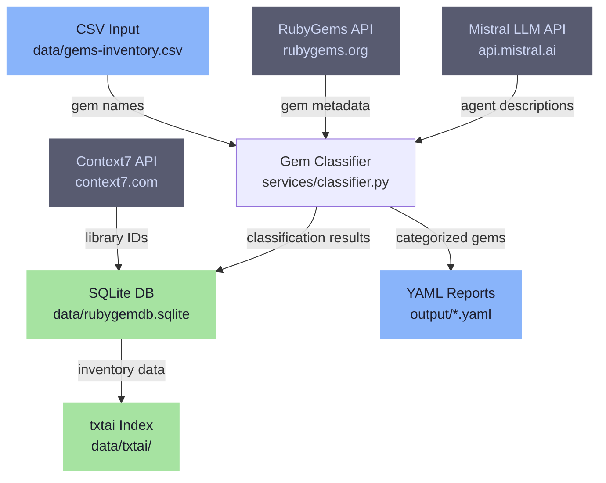

<div align="center">

# RubyGemDB

**Ruby gem classification and analysis through heuristic taxonomy and LLM-augmented semantic search**

[](https://opensource.org/licenses/MIT)
[](https://www.python.org/downloads/)
[](https://docs.astral.sh/uv/)

</div>

---

## Features

- **21-Category Taxonomy** — Classifies gems into functional categories (web_frameworks, cli_libraries, ai_llm, etc.), each tagged with a stack layer (substrate, plumbing, composition, quality), with confidence scoring and sub-category detection from dependency analysis
- **Heuristic + LLM Hybrid** — Fast pattern matching for obvious cases, with Mistral-powered LLM fallback when heuristic confidence drops below 0.7
- **Semantic Vector Search** — txtai-powered embeddings with multi-query expansion and recency boosting for finding gems by natural language description
- **AI Agent with MCP Tools** — Context7 documentation retrieval and Codebase Memory integration via Model Context Protocol
- **Phase-Walking Advisor** — Conversational project-brief chat that decomposes a brief into capabilities, then walks skeleton → input → processing → output phases, presenting gem picks you can accept, swap, ask about, skip, or revisit — exportable as markdown and JSON
- **Interactive TUI** — Textual-based terminal UI for browsing, filtering, editing, and exporting classified gems with real-time classification
- **Batch CLI Pipeline** — Headless processing of gem inventories with metadata verification, classification, and YAML report generation
- **Risk Assessment** — Invasiveness, coupling, and abstraction leak scoring for architectural impact analysis

---

## Architecture



## External Integrations



---

## Classification Taxonomy

### Primary Categories

| Category | Layer | Description | Risk Level |
|----------|-------|-------------|------------|
| `core_extensions` | substrate | Core language extensions, stdlib-style utilities | Invasiveness: 3/5 |
| `native_bindings` | substrate | FFI, C extension toolchains, binary formats | Invasiveness: 3/5 |
| `servers_concurrency` | substrate | App servers, async runtimes, thread/process pools | Invasiveness: 3/5 |
| `http_networking` | plumbing | HTTP clients, API SDKs, websockets, networking | Invasiveness: 2/5 |
| `persistence` | plumbing | ORMs, database drivers, caches, attachments | Invasiveness: 4/5 |
| `background_jobs` | plumbing | Job queues and workflow runners | Invasiveness: 3/5 |
| `document_parsing` | plumbing | HTML/XML/Markdown/CSV/PDF parsing, serialization | Invasiveness: 2/5 |
| `document_generation` | plumbing | PDF/API doc generation, syntax highlighting | Invasiveness: 2/5 |
| `text_search` | plumbing | Classical NLP, fuzzy matching, search engines | Invasiveness: 3/5 |
| `media_processing` | plumbing | Image, audio, and video processing | Invasiveness: 2/5 |
| `web_frameworks` | composition | Web frameworks, routing, Rack middleware, templating | Invasiveness: 5/5 |
| `cli_libraries` | composition | CLI frameworks, terminal UI/styling/output | Invasiveness: 1/5 |
| `gui_desktop` | composition | Desktop GUI frameworks, game dev libraries | Invasiveness: 3/5 |
| `static_site_generation` | composition | Static site generators, themes, plugins | Invasiveness: 3/5 |
| `ai_llm` | composition | LLM clients, agent frameworks, embeddings, prompts | Invasiveness: 3/5 |
| `mcp_tooling` | composition | Model Context Protocol clients and servers | Invasiveness: 2/5 |
| `runtime_validation` | composition | Runtime validation, schemas, typed structs | Invasiveness: 2/5 |
| `security_auth` | composition | Authentication, authorization, cryptography | Invasiveness: 4/5 |
| `testing_qa` | quality | Test frameworks, factories, mocks, browser drivers | Invasiveness: 1/5 |
| `code_quality_typing` | quality | Linters, static analyzers, type systems, LSPs | Invasiveness: 2/5 |
| `developer_tools` | quality | Debuggers, profilers, REPLs, logging, gem tooling | Invasiveness: 1/5 |

### Sub-Category Detection

Automatic sub-category extraction from dependency names:

- `rails`, `sidekiq`, `background_jobs`, `activejob`, `server`
- `database`, `redis`, `search`, `auth`, `api`
- `serialization`, `spreadsheet`, `pdf`, `cloud`
- `monitoring`, `messaging`

---

## AI Agent Architecture

### Hybrid Search Pipeline

Gem retrieval combines two signals fused with Reciprocal Rank Fusion (K=60):

1. **Vector Retrieval** — txtai embedding similarity (`ollama/embeddinggemma`) with a 30% recency boost for recently updated gems
2. **Full-Text Search** — SQLite FTS5 index (`gem_fts`) over gem names and descriptions; tries a strict AND-joined match first and falls back to the looser OR match, so single-token coincidences do not outrank full matches
3. **RRF Fusion** — `services/hybrid_search.py` merges both rankings into one candidate list; degrades gracefully to whichever signal is available
4. **Category Narrowing** — when a phase filter is active, query tokens restrict results to the categories they actually target (stem-matched against category keywords), so a "chunk text" query no longer pulls in persistence or media gems

### Advisor Conversation Flow

The chat tab (`services/advisor.py`) is card-driven, not a phase walk:

1. **Card** — the brief is extracted into a structured requirement card (deliverable, inputs, transforms, outputs, constraints, open questions) and shown for review. Reply `go` to propose, or edit any slot in plain English ("inputs are DOCX files, not PDFs").
2. **Proposal** — each searchable slot runs its own hybrid search, restricted to the categories of its build phase (deliverable → skeleton, inputs → input, transforms → processing, outputs → output). Every card item is searched separately and merged by best score, so one item's keywords cannot drown out another's. The whole stack is presented at once, grouped by slot, with one-line reasons.
3. **Iteration** — you steer the whole proposal with actions or free-form feedback:
   - `accept` — confirm the proposed stack as the final pick
   - `remove <gem>` — drop a gem from the proposal
   - `add <gem> [<gem> ...]` — manually include inventoried gems that were never offered
   - `swap <gem> for <gem>` — replace one gem with another candidate from the same slot
   - `retry <slot> <focus>` — re-search a slot with your focus words folded into the query; if no slot is named, the focus infers the slot from the categories it targets
   - `edit <slot> ...` — change the card; only the affected slots are re-searched
   - `ask <gem> <question>` — LLM answer about a specific gem
   - `start over` — reset with a new brief
   - anything else reads as conversational feedback — the intent LLM answers it and suggests the next action

Export writes `output/chat_exports/chat_<timestamp>.md` and `.json` containing the brief, the requirement card, the confirmed stack by slot, and the transcript.

### MCP Tool Integration

| Tool | Purpose |
|------|---------|
| `search_memory_tool` | Hybrid (vector + FTS5) gem search backing the advisor's slot candidates |
| `fetch_rubygems_info` | Fetch detailed gem metadata from RubyGems API |
| Context7 MCP | Retrieve library documentation and cheatsheets |
| Codebase Memory MCP | Search target project architecture |

### Agent Prompt Structure

The tool-calling agent behind `ask <gem> <question>` answers gem questions only — what a gem does, whether it fits the project, how two gems compare, its risks. It does not design implementation backlogs or scaffold code; advisor state, card and stack progression, and exports are handled deterministically by `services/advisor.py`.

---

## Installation & Accelerator Support

```bash
# Standard installation (CPU)
uv sync --extra cpu

# Optional CUDA installation (NVIDIA GPU acceleration)
uv sync --extra cuda
```

To force a specific accelerator at runtime, use `--cuda` or `--cpu`:
```bash
uv run rubygemdb --cuda stack "CLI data pipeline tool"
uv run rubygemdb --cpu process gems.csv --embed
```
Alternatively, set `CUDA_ENABLED=true` / `CUDA_ENABLED=false` or `DEVICE=cuda` in `.env`.

---

## Development

### Project Structure

```
rubygemdb/
├── src/rubygemdb/
│   ├── cli.py              # CLI batch processor
│   ├── agent.py            # Card-driven advisor with tool-calling agent
│   ├── core/
│   │   └── config.py       # Pydantic Settings configuration
│   ├── models/
│   │   ├── gem.py          # Pydantic data models
│   │   └── phases.py       # skeleton/input/processing/output phase mapping
│   ├── services/
│   │   ├── advisor.py      # Advisor conversation state machine
│   │   ├── advisor_export.py # Markdown/JSON chat export
│   │   ├── hybrid_search.py # FTS5 + vector search with RRF fusion
│   │   ├── classifier.py   # Heuristic + LLM classification
│   │   ├── rubygems.py     # RubyGems API client
│   │   ├── llm.py          # Mistral LLM client
│   │   └── context7.py     # Context7 API client
│   ├── storage/
│   │   ├── base.py         # Storage interface
│   │   ├── json_storage.py # JSON file storage
│   │   └── sqlite_storage.py # SQLite storage
│   └── ui/
│       └── tui.py          # Textual TUI application
├── tests/
│   ├── test_classifier.py
│   └── test_export.py
└── pyproject.toml
```

### Data Flow



---

## License

MIT License — see [LICENSE](LICENSE) for details.

---

## References

- [RubyGems API](https://rubygems.org/api/v1/gems/{name}.json)
- [Context7 API](https://context7.com/api/v2/)
- [txtai](https://neuml.github.io/txtai/)
- [Textual](https://textual.textualize.io/)
- [Pydantic](https://pydantic.dev/)
