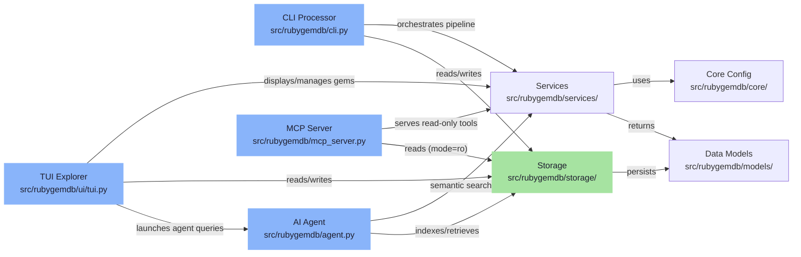
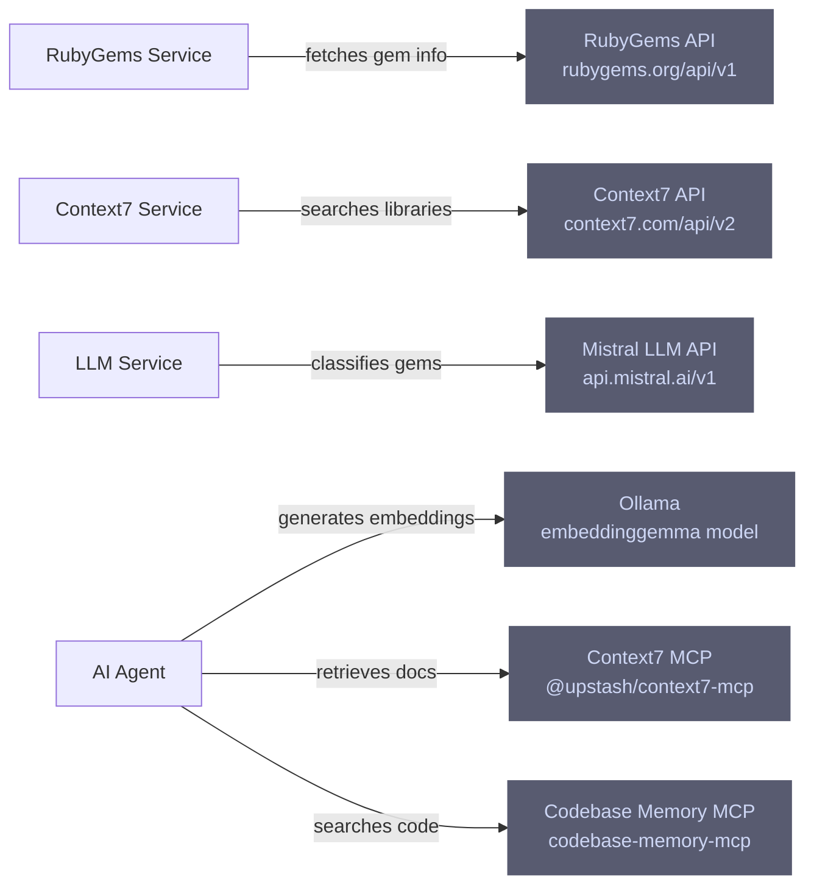
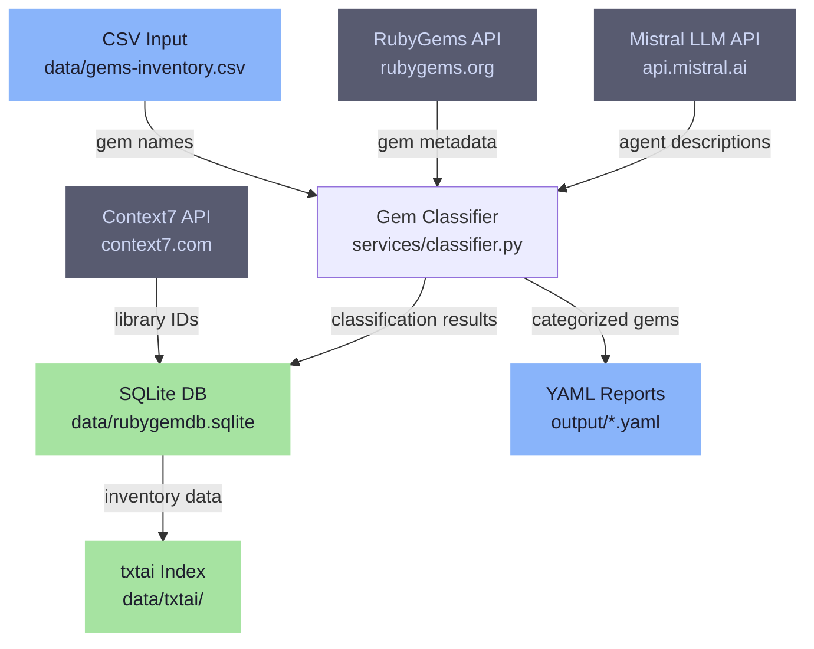

<div align="center">

# RubyGemDB

**Ruby gem classification and analysis through heuristic taxonomy and LLM-augmented semantic search**

[](https://opensource.org/licenses/MIT)
[](https://www.python.org/downloads/)
[](https://docs.astral.sh/uv/)

</div>

---

## Features

- **21-Category Taxonomy** — Classifies gems into functional categories (web_frameworks, cli_libraries, ai_llm, etc.), each tagged with a stack layer (substrate, plumbing, composition, quality), with confidence scoring and taxonomy-driven sub-category faceting — every category carries a curated facet vocabulary (e.g. web_frameworks → full_stack_frameworks, micro_frameworks, rack_middleware)
- **Heuristic + LLM Hybrid** — Fast pattern matching for obvious cases, with a Mistral-powered LLM pass that can override the heuristic category when confidence drops below 0.7
- **Semantic Vector Search** — txtai-powered embeddings with multi-query expansion and recency boosting for finding gems by natural language description
- **AI Agent with MCP Tools** — Context7 documentation retrieval and Codebase Memory integration via Model Context Protocol
- **Native MCP Server** — `rubygemdb-mcp` serves the taxonomy, gem metadata, and stack composition to coding agents (Claude Code, Antigravity, Cursor) over stdio or a background SSE daemon — strictly read-only
- **Contextual GraphRAG Pipeline** — On-demand containerized extraction of AST symbol hierarchies (`rubydex`) and structured documentation (`decode`) from gem source repositories, embedded into ephemeral `txtai` vector stores with 2-stage retrieval for deeply grounded coding agent chat and MCP queries
- **Interactive TUI** — Textual-based terminal UI for browsing, filtering, editing, and exporting classified gems with real-time classification
- **Batch CLI Pipeline** — Headless processing of gem inventories with metadata verification, classification, and YAML report generation
- **Risk Assessment** — Invasiveness, coupling, and abstraction leak scoring for architectural impact analysis

---

## Architecture



## External Integrations



---

## Classification Taxonomy

### Primary Categories

| Category | Layer | Description | Risk Level |
|----------|-------|-------------|------------|
| `core_extensions` | substrate | Core language extensions, stdlib-style utilities | Invasiveness: 3/5 |
| `native_bindings` | substrate | FFI, C extension toolchains, binary formats | Invasiveness: 3/5 |
| `servers_concurrency` | substrate | App servers, async runtimes, thread/process pools | Invasiveness: 3/5 |
| `http_networking` | plumbing | HTTP clients, API SDKs, websockets, networking | Invasiveness: 2/5 |
| `persistence` | plumbing | ORMs, database drivers, caches, attachments | Invasiveness: 4/5 |
| `background_jobs` | plumbing | Job queues and workflow runners | Invasiveness: 3/5 |
| `document_parsing` | plumbing | HTML/XML/Markdown/CSV/PDF parsing, serialization | Invasiveness: 2/5 |
| `document_generation` | plumbing | PDF/API doc generation, syntax highlighting | Invasiveness: 2/5 |
| `text_search` | plumbing | Classical NLP, fuzzy matching, search engines | Invasiveness: 3/5 |
| `media_processing` | plumbing | Image, audio, and video processing | Invasiveness: 2/5 |
| `web_frameworks` | composition | Web frameworks, routing, Rack middleware, templating | Invasiveness: 5/5 |
| `cli_libraries` | composition | CLI frameworks, terminal UI/styling/output | Invasiveness: 1/5 |
| `gui_desktop` | composition | Desktop GUI frameworks, game dev libraries | Invasiveness: 3/5 |
| `static_site_generation` | composition | Static site generators, themes, plugins | Invasiveness: 3/5 |
| `ai_llm` | composition | LLM clients, agent frameworks, embeddings, prompts | Invasiveness: 3/5 |
| `mcp_tooling` | composition | Model Context Protocol clients and servers | Invasiveness: 2/5 |
| `runtime_validation` | composition | Runtime validation, schemas, typed structs | Invasiveness: 2/5 |
| `security_auth` | composition | Authentication, authorization, cryptography | Invasiveness: 4/5 |
| `testing_qa` | quality | Test frameworks, factories, mocks, browser drivers | Invasiveness: 1/5 |
| `code_quality_typing` | quality | Linters, static analyzers, type systems, LSPs | Invasiveness: 2/5 |
| `developer_tools` | quality | Debuggers, profilers, REPLs, logging, gem tooling | Invasiveness: 1/5 |

### Sub-Category Facets

Every category defines a `sub_categories` vocabulary — facet slugs mapped to example gems (80 facets across the 21 categories, defined in `src/rubygemdb/models/categories.py`). After the primary category is chosen, `GemClassifier.detect_sub_categories` scores the winning category's facets against the gem's name, description, and dependencies, keeping the best matches. When the LLM overrides the primary category, detection re-runs so facets always match the final category.

Detected facets persist in the `classified_gems.sub_categories` SQLite column, flow into the per-category YAML output, and render in the TUI details pane. `tests/test_categories.py` pins the facet vocabulary — renaming a facet breaks the tests.

---

## AI Agent Architecture

### Hybrid Search Pipeline

Gem retrieval combines two signals fused with Reciprocal Rank Fusion (K=60):

1. **Vector Retrieval** — txtai embedding similarity (`ollama/embeddinggemma`) with a 30% recency boost for recently updated gems
2. **Full-Text Search** — SQLite FTS5 index (`gem_fts`) over gem names and descriptions; tries a strict AND-joined match first and falls back to the looser OR match, so single-token coincidences do not outrank full matches
3. **RRF Fusion** — `services/hybrid_search.py` merges both rankings into one candidate list; degrades gracefully to whichever signal is available
4. **Category Narrowing** — an explicit `category` slug restricts results directly; otherwise, when a phase filter is active, query tokens restrict results to the categories they actually target (stem-matched against category keywords), so a "chunk text" query no longer pulls in persistence or media gems

### Contextual GraphRAG Flow

The chat tab provides an on-demand, containerized GraphRAG pipeline for deep Ruby architecture and API exploration:

1. **Gem Selection & Sync** — Gems selected in the Explorer tab sync dynamically into the Chat tab, displaying interactive badges.
2. **Project Intention** — Define your architectural requirements or project context in the intention input field.
3. **Containerized Extraction** — Clicking `Build GraphRAG Context` spins up the ephemeral `rubygemdb-indexer:latest` container (prioritizing Podman, fallback to Docker), running `Rubydex::Graph` (AST, class hierarchy, method calls) and `Decode::Index` (docstrings, `@parameter`, `@returns`, and `@example` code snippets) over mounted shallow-cloned gem repositories. If git cloning fails, the system automatically falls back to unpacking released `.gem` archives.
4. **Ephemeral Vector Store** — Host Python ingests the normalized `graph.json` artifact into an ephemeral `txtai` index, caching the graph and vector embeddings by a deterministic hash of the selected gem set.
5. **Two-Stage Grounded Retrieval** — Queries execute semantic vector search for top-K symbol and example nodes, followed by 1-hop graph neighborhood expansion across inheritance, call relations, parameter types, and attached code examples.
6. **Transcript Export** — Export writes `output/chat_exports/graphrag_chat_<timestamp>.md` and `.json` containing active intention, indexed gems, full conversation history, and grounded symbol summaries.

### MCP Tool Integration

| Tool | Purpose |
|------|---------|
| `search_memory_tool` | Hybrid (vector + FTS5) gem search over the database |
| `fetch_rubygems_info` | Fetch detailed gem metadata from RubyGems API |
| `query_gem_graphrag` | 2-stage GraphRAG retrieval over indexed gem graphs |
| `build_gem_graphrag` | Pre-warm and index AST symbols and documentation for gems |
| Context7 MCP | Retrieve library documentation and cheatsheets |
| Codebase Memory MCP | Search target project architecture |

### Agent Prompt Structure

The assistant grounds its answers in the exact method signatures, decode parameter types, verified code examples, and call relationships retrieved from the gem's source code graph. Answers cite exact symbol names, module nesting, and integration patterns rather than hallucinating APIs.

---

## MCP Server (`rubygemdb-mcp`)

RubyGemDB exposes a native Model Context Protocol (MCP) server so coding agents (Claude Code, Antigravity, OpenCode, Cursor) can directly discover Ruby gems, query classifications and architectural layers, and compose layered gem stacks.

### CLI Usage & Lifecycle Management

- **Stdio Mode (Default)**: Runs as a child-process communicating over standard I/O (recommended for Claude Code, Antigravity, Cursor):
  ```bash
  uv run rubygemdb-mcp
  ```
- **SSE Daemon Mode**: Run detached in the background over Server-Sent Events (SSE):
  ```bash
  uv run rubygemdb-mcp --daemon start --port 8011    # start background server
  uv run rubygemdb-mcp --daemon status               # check running status
  uv run rubygemdb-mcp --daemon stop                 # stop server cleanly
  uv run rubygemdb-mcp --sse                         # shortcut for --daemon start
  ```

Full flag surface (`rubygemdb-mcp --help`):

| Flag | Default | Purpose |
|------|---------|---------|
| `--transport` | `stdio` | Transport: `stdio` or `sse` (bare `--transport sse` runs in the foreground) |
| `--host` | `127.0.0.1` | SSE bind address |
| `--port` | `8000` | SSE port (the examples above pin `8011`) |
| `--sse` | — | Shortcut for `--daemon start` |
| `--daemon` | — | `start` / `status` / `stop`; `start` is idempotent — an already-running daemon prints a notice and exits 0 |
| `--foreground` | — | Run SSE in the foreground (used by the daemon worker; handy for debugging) |
| `--pid-file` | `data/mcp.pid` | PID file; a `mcp.json` sidecar beside it records host/port |
| `--log-file` | `data/mcp.log` | Daemon log |

Daemon artifacts land in `data/`: `mcp.pid`, the `mcp.json` host/port sidecar, and `mcp.log`. Stale PID files are detected and cleaned up by `status` and `stop`.

### Exposed Capabilities

- **Tools (Read-Only)**:
  - `search_gems(query, category=None, phase=None, limit=10)`: Sub-millisecond SQLite FTS5 search. `category` takes one of the 21 category slugs; `phase` takes `skeleton`, `input`, `processing`, or `output`. The txtai vector index is consulted only when FTS5 returns zero hits.
  - `get_gem(name)`: Complete architectural metadata, layer, sub-categories, agent description, dependencies, signals, and risks. Gems present in the inventory but not yet classified return the same shape with `classified: false` and zero confidence; unknown names return an `error` object.
  - `compose_stack(query)`: Composes layered gem stack manifest (substrate -> quality) and Gemfile snippet. Runs in read-only mode — curated seed gems are not written back to the inventory.
  - `list_categories()`: Lists 21 architectural categories, stack layers, descriptions, and curated base gems.
  - `build_gem_graphrag(gems, intention="")`: Pre-warms and builds the containerized AST symbol and decode graph index for a set of gems.
  - `query_gem_graphrag(gems, query, intention=None)`: Executes 2-stage GraphRAG retrieval over indexed gem graphs, returning exact AST signatures, decode parameter types, and code examples.

Every tool opens the SQLite database read-only (`mode=ro`), and in that mode all mutating storage methods raise `PermissionError` — read-only by construction, not by convention.
- **Resources**:
  - `rubygemdb://taxonomy`: Markdown guide of all 21 categories, layers, and sub-category vocabularies.
  - `rubygemdb://stack-seeds`: Markdown guide of curated base gems grouped by layer.
- **Prompts**:
  - `design-ruby-stack(project_description)`: Guided prompt for formulating queries and layering architectures.
  - `gem-architect-rag(gems, intention, task)`: Grounded architecture prompt using containerized gem AST and decode graphs.

### Client Configuration Snippets

#### Claude Code (`~/.claude.json` or `.claude.json`)
```json
{
  "mcpServers": {
    "rubygemdb": {
      "command": "uv",
      "args": ["--directory", "/path/to/rubygemdb", "run", "rubygemdb-mcp"]
    }
  }
}
```

#### Antigravity / Cursor (`mcp_config.json`)
```json
{
  "mcpServers": {
    "rubygemdb": {
      "command": "uv",
      "args": ["--directory", "/path/to/rubygemdb", "run", "rubygemdb-mcp"]
    }
  }
}
```

#### SSE Setup (Remote or Multi-Agent)
Start the background daemon:
```bash
uv run rubygemdb-mcp --daemon start --port 8011
```
Configure your client with URL `http://127.0.0.1:8011/sse`:
```json
{
  "mcpServers": {
    "rubygemdb": {
      "url": "http://127.0.0.1:8011/sse"
    }
  }
}
```

---

## Installation & Accelerator Support

```bash
# Standard installation (CPU)
uv sync --extra cpu

# Optional CUDA installation (NVIDIA GPU acceleration)
uv sync --extra cuda
```

To force a specific accelerator at runtime, use `--cuda` or `--cpu`:
```bash
uv run rubygemdb --cuda stack "CLI data pipeline tool"
uv run rubygemdb --cpu process gems.csv --embed
```
Alternatively, set `CUDA_ENABLED=true` / `CUDA_ENABLED=false` or `DEVICE=cuda` in `.env`.

---

## Development

### Project Structure

```
rubygemdb/
├── src/rubygemdb/
│   ├── cli.py              # CLI batch processor
│   ├── agent.py            # Contextual GraphRAG chat & tool-calling agent
│   ├── mcp_server.py       # Native MCP server & daemon lifecycle (FastMCP)
│   ├── core/
│   │   └── config.py       # Pydantic Settings configuration
│   ├── models/
│   │   ├── gem.py          # Pydantic data models
│   │   ├── categories.py   # Single source of truth: 21 categories, layers, sub-category facets
│   │   └── phases.py       # skeleton/input/processing/output phase mapping
│   ├── services/
│   │   ├── container_runner.py # Podman/Docker runner for indexer container
│   │   ├── gem_fetcher.py  # Git shallow-cloner with .gem unpack fallback
│   │   ├── graphrag.py     # Two-stage GraphRAG retrieval & prompt synthesizer
│   │   ├── hybrid_search.py # FTS5 + vector search with RRF fusion
│   │   ├── classifier.py   # Heuristic + LLM classification with sub-category faceting
│   │   ├── embedding_scorer.py # txtai embedding similarity vs category descriptions
│   │   ├── stack.py        # Layered gem-stack composition
│   │   ├── prune.py        # Overlap/stale gem prune reports
│   │   ├── rubygems.py     # RubyGems API client
│   │   ├── llm.py          # Mistral LLM client
│   │   └── context7.py     # Context7 API client with repo-anchored ID verification
│   ├── storage/
│   │   ├── base.py         # Storage interface
│   │   ├── json_storage.py # JSON file storage
│   │   └── sqlite_storage.py # SQLite storage
│   └── ui/
│       └── tui.py          # Textual TUI application
├── docker/
│   ├── indexer.Dockerfile  # Ruby 4.0.4 runtime packaging rubydex, decode, bake
│   └── extract_graph.rb    # AST symbol and documentation extraction script
├── tests/
│   └── (litmus suite)      # Taxonomy + facets, classification, GraphRAG, MCP, daemon lifecycle
└── pyproject.toml
```

### Data Flow



---

## License

MIT License — see [LICENSE](LICENSE) for details.

---

## References

- [RubyGems API](https://rubygems.org/api/v1/gems/{name}.json)
- [Context7 API](https://context7.com/api/v2/)
- [txtai](https://neuml.github.io/txtai/)
- [Textual](https://textual.textualize.io/)
- [Pydantic](https://pydantic.dev/)
