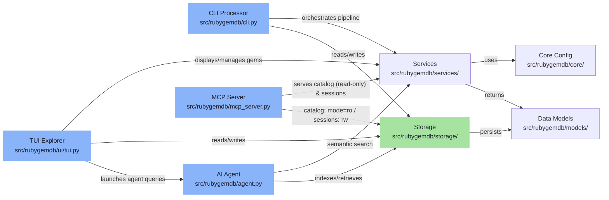
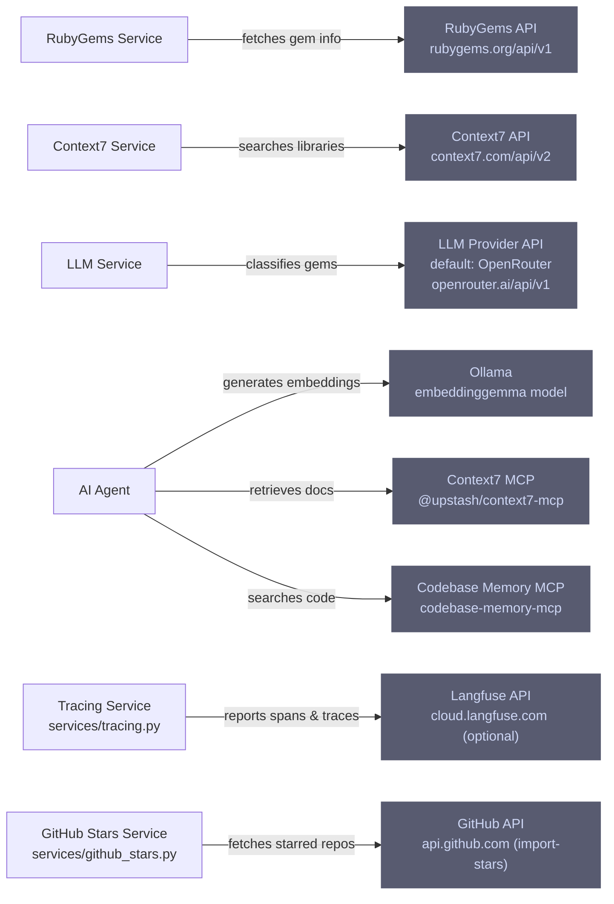
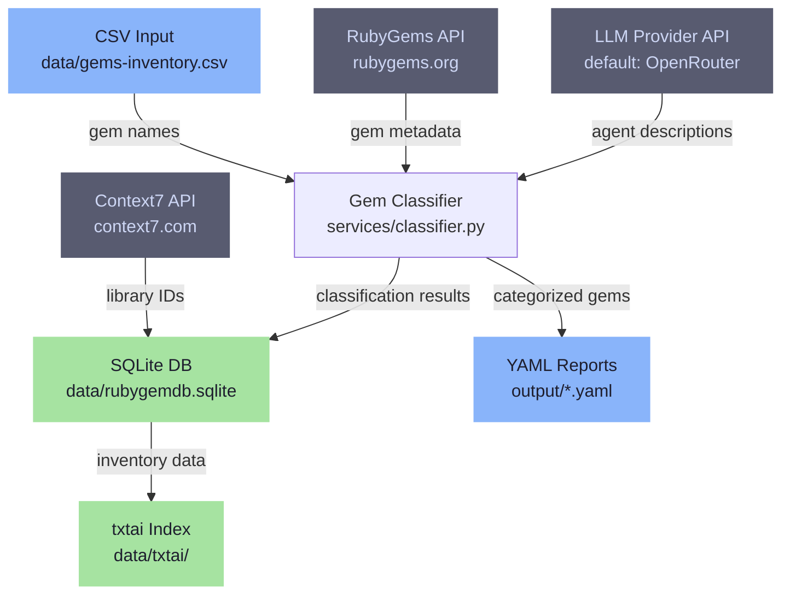

<div align="center">

# RubyGemDB

**Ruby gem classification and analysis through heuristic taxonomy and LLM-augmented semantic search**

[](https://opensource.org/licenses/MIT)
[](https://www.python.org/downloads/)
[](https://docs.astral.sh/uv/)

</div>

---

## Features

- **21-Category Taxonomy** — Classifies gems into functional categories (web_frameworks, cli_libraries, ai_llm, etc.), each tagged with a stack layer (substrate, plumbing, composition, quality), with confidence scoring and taxonomy-driven sub-category faceting — every category carries a curated facet vocabulary (e.g. web_frameworks → full_stack_frameworks, micro_frameworks, rack_middleware)
- **Heuristic + LLM Hybrid** — Fast pattern matching for obvious cases, with an LLM pass through the configured provider (default `openrouter`/`upstage/solar-mini4`, config.py:18-24; Mistral when `RUBYGEMDB_PROVIDER=mistral`) that can override the heuristic category when confidence drops below 0.7
- **Semantic Vector Search** — txtai-powered embeddings with a fixed +0.005 rank lift for gems marked preferred (hybrid_search.py) for finding gems by natural language description
- **Local Query Expansion & Cross-Encoder Reranking** — optional, off-by-default retrieval quality stages: a local Qwen3 GGUF model (`mradermacher/qmd-query-expansion-1.7B-GGUF`) expands queries into lexical and vector variations, multi-pass results fuse via Reciprocal Rank Fusion, and a Qwen3 cross-encoder (`ggml-org/Qwen3-Reranker-0.6B-Q8_0-GGUF`) re-scores the candidate pool — both stages fall back to baseline retrieval when disabled or offline (query_expander.py, reranker.py)
- **AI Agent with MCP Tools** — Context7 documentation retrieval and Codebase Memory integration via Model Context Protocol
- **Native MCP Server** — `rubygemdb-mcp` serves the taxonomy, gem metadata, stack composition, and GraphRAG sessions to coding agents (Claude Code, Antigravity, Cursor) over stdio or a background SSE daemon — the gem catalog is strictly read-only
- **Contextual GraphRAG Pipeline** — On-demand containerized extraction of AST symbol hierarchies (`rubydex`) and structured documentation (`decode`) from gem source repositories, embedded into ephemeral `txtai` vector stores with 2-stage retrieval for deeply grounded coding agent chat and MCP queries
- **Persistent GraphRAG Sessions** — Conversations, retrieved-node citations, and execution traces persist in a dedicated `data/sessions.sqlite` store; the TUI auto-restores the most recent session on open, and MCP clients can list, inspect, resume, export, and delete sessions
- **Grounded Citations & Anti-Hallucination Contract** — Every method, class, module, and code example in the retrieved GraphRAG context carries a sequential `[C1]`-style citation tag with its source file, and grounded answers are prompt-constrained to the APIs those citations actually contain: replies cite inline, close with a `### Citations` summary, state unsupported capabilities explicitly, and supply missing logic as clearly-distinguished custom Ruby rather than invented gem APIs
- **Optional Langfuse Observability** — Langfuse v5 tracing context managers wrap gem classification, LLM calls (with token usage), hybrid search, GraphRAG retrieval, agent chat turns, and MCP GraphRAG tools, grouping traces by session id; off unless `LANGFUSE_PUBLIC_KEY`/`LANGFUSE_SECRET_KEY` are set, and `LANGFUSE_ENABLED=false` disables it even then — when disabled the tracer yields no-op observations and never initializes the client
- **Interactive TUI** — Textual-based terminal UI for browsing, filtering, editing, and exporting classified gems with real-time classification
- **Batch CLI Pipeline** — Headless processing of gem inventories with metadata verification, classification, and YAML report generation
- **Curated Gem-Stack Composition** — `rubygemdb stack` turns a context query into a compact, layered stack manifest (substrate -> quality) plus a Gemfile snippet via two-stage retrieval and second-pass curation (LLM synthesis or offline fallback), with category density limits and task-specific role descriptions — base seeds only join the candidate pool when their category is relevant to the query; `--max-gems` (default 10) caps stack density; output is advisory, not a dependency resolver
- **GitHub Starred Gem Import** — `rubygemdb import-stars` fetches starred Ruby repositories, resolves them to published RubyGems via repo-name matching or remote gemspec inspection, enriches inventory records with source repos and Context7 IDs, infers GenAI tooling roles, and runs a prune audit that removes nothing until you pass `--apply-prune`, `--select-prune`, or `--prune-list`; set `GITHUB_TOKEN` (or authenticate via the `gh` CLI) to raise GitHub API rate limits
- **Interactive Gem Pruning** — `rubygemdb prune` audits the inventory for stale (3+ years without release) or overlapping gems and removes the ones you choose through a dual-engine CLI multi-selector (`gum choose --no-limit`, falling back to a native Textual `SelectionList`); candidates come from an automated audit, a markdown report, or a plain text list
- **Risk Assessment** — Invasiveness, coupling, and abstraction leak scoring for architectural impact analysis

---

## Architecture

RubyGemDB's runtime has four user-facing entry points — CLI, TUI, agent, MCP server — over a shared core/services/storage spine:



## External Integrations

RubyGemDB talks to the external services below over HTTP or MCP:



---

## Installation & Accelerator Support

Install is one uv sync per accelerator; every later stage is optional and off by default:

```bash
# Standard installation (CPU)
uv sync --extra cpu

# Optional CUDA installation (NVIDIA GPU acceleration)
uv sync --extra cuda
```

To force a specific accelerator at runtime, use `--cuda` or `--cpu`:
```bash
uv run rubygemdb --cuda stack "CLI data pipeline tool" --max-gems 6
uv run rubygemdb --cpu process gems.csv --embed
```
Alternatively, set `CUDA_ENABLED=true` / `CUDA_ENABLED=false` or `DEVICE=cuda` in `.env`.

Optional retrieval-quality models: enabling `QUERY_EXPANSION_ENABLED` or `RERANKER_ENABLED` lazily downloads GGUF models (~1.1 GB and ~640 MB) from Hugging Face into `data/models/` on first use. No model setup is needed to run the baseline pipeline — both stages are off by default.

Optional Langfuse observability: set `LANGFUSE_PUBLIC_KEY` and `LANGFUSE_SECRET_KEY` to enable tracing (plus `LANGFUSE_HOST` or `LANGFUSE_BASE_URL` for a self-hosted instance — the default is `https://cloud.langfuse.com`). Tracing is off unless both keys are set, and `LANGFUSE_ENABLED=false` disables it even when they are. No keys, no client: the tracer degrades to no-op observations and never initializes the Langfuse SDK. Traced operations cover classification, LLM calls, hybrid search, GraphRAG retrieval, agent chat turns, and MCP GraphRAG tools; the CLI flushes buffered traces when a command finishes.

Optional embedding cache retention: configure `EMBEDDINGS_CACHE_MAX_ENTRIES` (default: 100,000) and `EMBEDDINGS_CACHE_TTL_DAYS` (default: 180) to govern universal vector cache capacity and TTL retention.

Agent output cap: `AGENT_MAX_TOKENS` (default: 4096) limits GraphRAG agent response length — raise it when long, citation-tagged implementations truncate.

GitHub access for `import-stars`: set `GITHUB_TOKEN` (or `GH_TOKEN`); when unset, the client falls back to `gh auth token` from the GitHub CLI.

### Embedding Cache Management

Manage and reclaim disk space from the shared vector embedding cache (`data/cache/embeddings_cache.sqlite`):
```bash
uv run rubygemdb cache stats                           # inspect vector counts, models, and file sizes
uv run rubygemdb cache stats --model "model_name"     # filter stats by embedding model
uv run rubygemdb cache clear                           # purge all vectors and reclaim disk space via VACUUM
uv run rubygemdb cache clear --model "model_name"     # clear vectors for a specific model only
uv run rubygemdb cache prune                           # prune expired vectors (>180d) and cap at 100k entries
uv run rubygemdb cache prune --max-age-days 90 --max-entries 50000  # custom retention limits
uv run rubygemdb reclassify --clear-embeddings-cache  # purge cache during fresh-start reclassification
```
Pass `--no-vacuum` on `clear` or `prune` to skip physical SQLite page reclamation. Opportunistic inline pruning triggers during `put_many` batch writes when capacity thresholds are exceeded.

---

## Classification Taxonomy

Every gem lands in exactly one of 21 categories, each tagged to one of four stack layers — substrate, plumbing, composition, quality — inventoried below.

### Primary Categories

| Category | Layer | Description | Risk Level |
|----------|-------|-------------|------------|
| `core_extensions` | substrate | Core language extensions, stdlib-style utilities | Invasiveness: 3/5 |
| `native_bindings` | substrate | FFI, C extension toolchains, binary formats | Invasiveness: 3/5 |
| `servers_concurrency` | substrate | App servers, async runtimes, thread/process pools | Invasiveness: 3/5 |
| `http_networking` | plumbing | HTTP clients, API SDKs, websockets, networking | Invasiveness: 2/5 |
| `persistence` | plumbing | ORMs, database drivers, caches, attachments | Invasiveness: 4/5 |
| `background_jobs` | plumbing | Job queues and workflow runners | Invasiveness: 3/5 |
| `document_parsing` | plumbing | HTML/XML/Markdown/CSV/PDF parsing, serialization | Invasiveness: 2/5 |
| `document_generation` | plumbing | PDF/API doc generation, syntax highlighting | Invasiveness: 2/5 |
| `text_search` | plumbing | Classical NLP, fuzzy matching, search engines | Invasiveness: 3/5 |
| `media_processing` | plumbing | Image, audio, and video processing | Invasiveness: 2/5 |
| `web_frameworks` | composition | Web frameworks, routing, Rack middleware, templating | Invasiveness: 5/5 |
| `cli_libraries` | composition | CLI frameworks, terminal UI/styling/output | Invasiveness: 1/5 |
| `gui_desktop` | composition | Desktop GUI frameworks, game dev libraries | Invasiveness: 3/5 |
| `static_site_generation` | composition | Static site generators, themes, plugins | Invasiveness: 3/5 |
| `ai_llm` | composition | LLM clients, agent frameworks, embeddings, prompts | Invasiveness: 3/5 |
| `mcp_tooling` | composition | Model Context Protocol clients and servers | Invasiveness: 2/5 |
| `runtime_validation` | composition | Runtime validation, schemas, typed structs | Invasiveness: 2/5 |
| `security_auth` | composition | Authentication, authorization, cryptography | Invasiveness: 4/5 |
| `testing_qa` | quality | Test frameworks, factories, mocks, browser drivers | Invasiveness: 1/5 |
| `code_quality_typing` | quality | Linters, static analyzers, type systems, LSPs | Invasiveness: 2/5 |
| `developer_tools` | quality | Debuggers, profilers, REPLs, logging, gem tooling | Invasiveness: 1/5 |

### Sub-Category Facets

Every category defines a `sub_categories` vocabulary — facet slugs mapped to example gems (80 facets across the 21 categories, defined in `src/rubygemdb/models/categories.py`). After the primary category is chosen, `GemClassifier.detect_sub_categories` scores the winning category's facets against the gem's name, description, and dependencies, keeping the best matches. When the LLM overrides the primary category (the sub-0.7 gate from Features), detection re-runs so facets always match the final category.

Detected facets persist in the `classified_gems.sub_categories` SQLite column, flow into the per-category YAML output, and render in the TUI details pane. `tests/test_categories.py` pins the facet vocabulary — renaming a facet breaks the tests.

---

## AI Agent Architecture

The agent path runs hybrid retrieval, containerized GraphRAG grounding, MCP tool calls, and a citation-bound prompt contract, in that order:

### Hybrid Search Pipeline

Gem retrieval combines two signals fused with Reciprocal Rank Fusion (K=60):

1. **Query Expansion (optional)** — when `QUERY_EXPANSION_ENABLED=true`, `services/query_expander.py` expands the query into lexical and vector variations with a local GGUF model; each variation is searched alongside the original query
2. **Vector Retrieval** — txtai embedding similarity (ollama/embeddinggemma-2:440m, the settings default) over child chunks, deduplicated by parent gem
3. **Full-Text Search** — SQLite FTS5 index (`gem_fts`) over gem names and descriptions; tries a strict AND-joined match first and falls back to the looser OR match, so single-token coincidences do not outrank full matches
4. **RRF Fusion** — `services/hybrid_search.py` merges the rankings of every pass into one candidate list; a pass that raises contributes no ranking
5. **Cross-Encoder Reranking (optional)** — when `RERANKER_ENABLED=true`, the candidate pool (oversampled to `top_k × RERANKER_CANDIDATE_MULTIPLIER`, default 3, clamped 15–50) is re-scored by the local Qwen3 reranker and truncated to the requested limit
6. **Category Narrowing** — an explicit `category` slug restricts results directly; otherwise, when a phase filter is active, query tokens restrict results to the categories they actually target (stem-matched against category keywords), so a "chunk text" query no longer pulls in persistence or media gems

### Contextual GraphRAG Flow

The chat tab provides an on-demand, containerized GraphRAG pipeline for deep Ruby architecture and API exploration:

1. **Gem Selection & Sync** — Gems selected in the Explorer tab sync dynamically into the Chat tab, displaying interactive badges.
2. **Project Intention** — Define your architectural requirements or project context in the intention input field.
3. **Containerized Extraction** — Clicking `Build GraphRAG Context` spins up the ephemeral `rubygemdb-indexer:latest` container (prioritizing Podman, fallback to Docker), running `Rubydex::Graph` (AST, class hierarchy, method calls) and `Decode::Index` (docstrings, `@parameter`, `@returns`, and `@example` code snippets) over mounted shallow-cloned gem repositories. If git cloning fails, services/gem_fetcher.py falls back to unpacking the released `.gem` archive.
4. **Ephemeral Vector Store** — Host Python ingests the normalized `graph.json` artifact into an ephemeral `txtai` index, caching the graph and vector embeddings by a deterministic hash of the selected gem set. A cache hit requires the saved txtai `embeddings` file — a partially-written cache rebuilds instead of loading empty — and vectorization itself draws on a universal embedding cache (`data/cache/embeddings_cache.sqlite`), so re-embedding known texts skips the embedding model.
5. **Two-Stage Grounded Retrieval** — Queries execute semantic vector search for top-K symbol and example nodes, followed by 1-hop graph neighborhood expansion across inheritance, call relations, parameter types, and attached code examples. With query expansion enabled, vector search runs over the original query plus its generated variations; with the reranker enabled, the candidate nodes are re-scored by the local cross-encoder before the neighborhood expansion. Both stages are off by default and fall back to baseline retrieval when their models are unavailable. Each retrieved symbol and example is assigned a sequential `[C1]`-style citation tag (source file included) and the assembled context ends with a Grounded Citations Index table.
6. **Session Persistence** — Each conversation lives in a persistent session in `data/sessions.sqlite`: every turn — message and citations — is saved as it happens and indexed into txtai as a `session_turn` document, and the chat tab auto-restores the most recent session — active gems, intention, chat history, and the last 200 execution traces — on startup. New Session and Delete Session buttons manage the session list. Existing stores migrate in place: the `rag_messages` table gains its `citations` column automatically on next launch.
7. **Transcript Export** — Export writes the session transcript to `output/chat_exports/graphrag_chat_<timestamp>.md` and `.json` containing active intention, indexed gems, full conversation history, and grounded symbol summaries. Cited turns render a `> **Grounded Citations:**` list in markdown and a `citations` array per message in JSON.

### MCP Tool Integration

| Tool | Purpose |
|------|---------|
| `search_memory_tool` | Hybrid (vector + FTS5) gem search over the database |
| `fetch_rubygems_info` | Fetch detailed gem metadata from RubyGems API |
| `query_gem_graphrag` | 2-stage GraphRAG retrieval over indexed gem graphs |
| `build_gem_graphrag` | Pre-warm and index AST symbols and documentation for gems |
| Context7 MCP | Retrieve library documentation and cheatsheets |
| Codebase Memory MCP | Search target project architecture |

Chat turns made through these tools persist to the session store — `build_gem_graphrag` and `query_gem_graphrag` accept an optional `session_id` and return the id of the session they recorded the turn in.

### Agent Prompt Structure

The assistant grounds its answers in the exact method signatures, decode parameter types, verified code examples, and call relationships retrieved from the gem's source code graph. Grounded turns run under a strict anti-hallucination prompt contract: every class, module, method, and pattern in the reply must be cited with its `[Cn]` tag, only APIs that appear in the retrieved citations may be used — no invented namespaces or parameters — and each answer closes with a `### Citations` summary section. When a gem lacks a needed capability, the contract requires the answer to say so explicitly, cite the methods that do exist, and supply the missing logic as clearly-distinguished custom application Ruby.

One boundary worth stating plainly: the contract binds grounded turns. Turns without a grounded context — no gems selected — run as ordinary ungrounded chat; the guardrail constrains answers that have sources, and it never refuses an answer outright. Agent output length is capped by `AGENT_MAX_TOKENS` (default: 4096); raise it if long grounded implementations truncate.

---

## MCP Server (`rubygemdb-mcp`)

RubyGemDB exposes a native Model Context Protocol (MCP) server so coding agents (Claude Code, Antigravity, OpenCode, Cursor) can directly discover Ruby gems, query classifications and architectural layers, and compose layered gem stacks.

### CLI Usage & Lifecycle Management

- **Stdio Mode (Default)**: Runs as a child-process communicating over standard I/O (recommended for Claude Code, Antigravity, Cursor):
  ```bash
  uv run rubygemdb-mcp
  ```
- **SSE Daemon Mode**: Run detached in the background over Server-Sent Events (SSE):
  ```bash
  uv run rubygemdb-mcp --daemon start --port 8011    # start background server
  uv run rubygemdb-mcp --daemon status               # check running status
  uv run rubygemdb-mcp --daemon stop                 # stop server cleanly
  uv run rubygemdb-mcp --sse                         # shortcut for --daemon start
  ```

Full flag surface (`rubygemdb-mcp --help`):

| Flag | Default | Purpose |
|------|---------|---------|
| `--transport` | `stdio` | Transport: `stdio` or `sse` (bare `--transport sse` runs in the foreground) |
| `--host` | `127.0.0.1` | SSE bind address |
| `--port` | `8000` | SSE port (the examples above pin `8011`) |
| `--sse` | — | Shortcut for `--daemon start` |
| `--daemon` | — | `start` / `status` / `stop`; `start` is idempotent — an already-running daemon prints a notice and exits 0 |
| `--foreground` | — | Run SSE in the foreground (used by the daemon worker; handy for debugging) |
| `--pid-file` | `data/mcp.pid` | PID file; a `mcp.json` sidecar beside it records host/port |
| `--log-file` | `data/mcp.log` | Daemon log |

Daemon artifacts land in `data/`: `mcp.pid`, the `mcp.json` host/port sidecar, and `mcp.log`. Stale PID files are detected and cleaned up by `status` and `stop`.

### Exposed Capabilities

- **Tools**:
  - `search_gems(query, category=None, phase=None, limit=10)`: SQLite FTS5 keyword search over the gem_fts table (strict AND match first, loose OR fallback); the txtai vector index is consulted only when FTS5 returns zero hits. `category` takes one of the 21 category slugs; `phase` takes `skeleton`, `input`, `processing`, or `output`.
  - `get_gem(name)`: Complete architectural metadata, layer, sub-categories, agent description, dependencies, signals, and risks. Gems present in the inventory but not yet classified return the same shape with `classified: false` and zero confidence; unknown names return an `error` object.
  - `compose_stack(query, max_gems=10)`: the MCP surface of `rubygemdb stack` (see Features) — same two-stage retrieval and curation; `max_gems` caps density; runs read-only (curated seed gems are not written back to the inventory).
  - `list_categories()`: Lists 21 architectural categories, stack layers, descriptions, and curated base gems.
  - `build_gem_graphrag(gems, intention="", session_id=None)`: Pre-warms and builds the containerized AST symbol and decode graph index for a set of gems; records the build in a session and returns its `session_id`.
  - `query_gem_graphrag(gems, query, intention=None, session_id=None)`: Executes 2-stage GraphRAG retrieval over indexed gem graphs, returning exact AST signatures, decode parameter types, and code examples, plus a top-level `citations` list (id, gem, file, node_id, node_type, symbol, signature, summary) for every retrieved symbol and code example. Each turn is persisted with its retrieved-node citations to the session store; the response carries the `session_id`.
  - `list_rag_sessions(limit=20)`: Lists sessions, most recently updated first.
  - `get_rag_session(session_id)`: Full session metadata plus its messages and execution traces.
  - `resume_rag_session(session_id)`: Resumes a session — pre-warms its gems' GraphRAG index and returns the last 5 messages. Full context restore happens in the TUI; this tool is a pre-warm plus summary.
  - `export_rag_session_transcript(session_id, format="markdown")`: Exports a session transcript as markdown or JSON.
  - `delete_rag_session(session_id)`: Deletes a session along with its messages and traces.

Catalog tools (`search_gems`, `get_gem`, `compose_stack`, `list_categories`) open the gem database read-only (`mode=ro`), and in that mode all mutating storage methods raise `PermissionError` — read-only by construction, not by convention. Session tools write only to the separate `data/sessions.sqlite` store; the gem catalog is never modified.
- **Resources**:
  - `rubygemdb://taxonomy`: Markdown guide of all 21 categories, layers, and sub-category vocabularies.
  - `rubygemdb://stack-seeds`: Markdown guide of curated base gems grouped by layer.
- **Prompts**:
  - `design-ruby-stack(project_description)`: Guided prompt for formulating queries and layering architectures.
  - `gem-architect-rag(gems, intention, task)`: Grounded architecture prompt using containerized gem AST and decode graphs.

### Client Configuration Snippets

#### Claude Code (`~/.claude.json` or `.claude.json`)
```json
{
  "mcpServers": {
    "rubygemdb": {
      "command": "uv",
      "args": ["--directory", "/path/to/rubygemdb", "run", "rubygemdb-mcp"]
    }
  }
}
```

#### Antigravity / Cursor (`mcp_config.json`)
```json
{
  "mcpServers": {
    "rubygemdb": {
      "command": "uv",
      "args": ["--directory", "/path/to/rubygemdb", "run", "rubygemdb-mcp"]
    }
  }
}
```

#### SSE Setup (Remote or Multi-Agent)
Start the background daemon:
```bash
uv run rubygemdb-mcp --daemon start --port 8011
```
Configure your client with URL `http://127.0.0.1:8011/sse`:
```json
{
  "mcpServers": {
    "rubygemdb": {
      "url": "http://127.0.0.1:8011/sse"
    }
  }
}
```

---

## Development

### Project Structure

```
rubygemdb/
├── .skills/
│   └── rubygemdb/
│       ├── SKILL.md        # Agent skill instructions & 3-tier routing
│       ├── install.py      # Skill installer for ~/.agents/skills
│       └── scripts/gem.py  # Tier 2 CLI helper & single-gem mutations
├── src/rubygemdb/
│   ├── cli.py              # CLI batch processor
│   ├── agent.py            # Contextual GraphRAG chat & tool-calling agent
│   ├── mcp_server.py       # Native MCP server & daemon lifecycle (FastMCP)
│   ├── core/
│   │   └── config.py       # Pydantic Settings configuration
│   ├── models/
│   │   ├── gem.py          # Pydantic data models
│   │   ├── categories.py   # Single source of truth: 21 categories, layers, sub-category facets
│   │   ├── phases.py       # skeleton/input/processing/output phase mapping
│   │   └── session.py      # RAGSession/RAGMessage/RAGTrace session models
│   ├── services/
│   │   ├── container_runner.py # Podman/Docker runner for indexer container
│   │   ├── gem_fetcher.py  # Git shallow-cloner with .gem unpack fallback
│   │   ├── graphrag.py     # Two-stage GraphRAG retrieval & prompt synthesizer
│   │   ├── hybrid_search.py # FTS5 + vector search with RRF fusion
│   │   ├── query_expander.py # Local GGUF query expansion (optional, off by default)
│   │   ├── reranker.py     # Local GGUF cross-encoder reranking (optional, off by default)
│   │   ├── model_manager.py # Hugging Face GGUF download & llama.cpp instance cache
│   │   ├── classifier.py   # Heuristic + LLM classification with sub-category faceting
│   │   ├── embedding_scorer.py # txtai embedding similarity vs category descriptions
│   │   ├── embedding_cache.py # SQLite-backed universal embedding cache (wrap_embeddings)
│   │   ├── stack.py        # Two-stage stack retrieval + second-pass curation
│   │   ├── prune.py        # Stale/overlap prune reports + interactive multi-select backend
│   │   ├── github_stars.py # GitHub starred-repo fetch & gem resolution (import-stars)
│   │   ├── import_stars_pipeline.py # Starred-gem import, enrichment & prune audit
│   │   ├── rubygems.py     # RubyGems API client
│   │   ├── llm.py          # LLM client (provider-configured)
│   │   ├── context7.py     # Context7 API client with repo-anchored ID verification
│   │   └── tracing.py      # Langfuse v5 observability context managers (optional; no-op fallback)
│   ├── storage/
│   │   ├── base.py         # Storage interface
│   │   ├── json_storage.py # JSON file storage
│   │   ├── sqlite_storage.py # SQLite storage
│   │   └── session_storage.py # Persistent GraphRAG session store (data/sessions.sqlite)
│   └── ui/
│       ├── tui.py          # Textual TUI application
│       └── selector.py     # Dual-engine CLI multi-select (gum or Textual SelectionList)
├── docker/
│   ├── indexer.Dockerfile  # Ruby 4.0.4 runtime packaging rubydex, decode, bake
│   └── extract_graph.rb    # AST symbol and documentation extraction script
├── tests/
│   └── (litmus suite)      # Taxonomy + facets, classification, GraphRAG, MCP, daemon lifecycle
└── pyproject.toml
```

### Data Flow



---

## License

MIT License — see [LICENSE](LICENSE) for details.

---

## References

- [RubyGems API](https://rubygems.org/api/v1/gems/{name}.json)
- [Context7 API](https://context7.com/api/v2/)
- [txtai](https://neuml.github.io/txtai/)
- [Textual](https://textual.textualize.io/)
- [Pydantic](https://pydantic.dev/)
